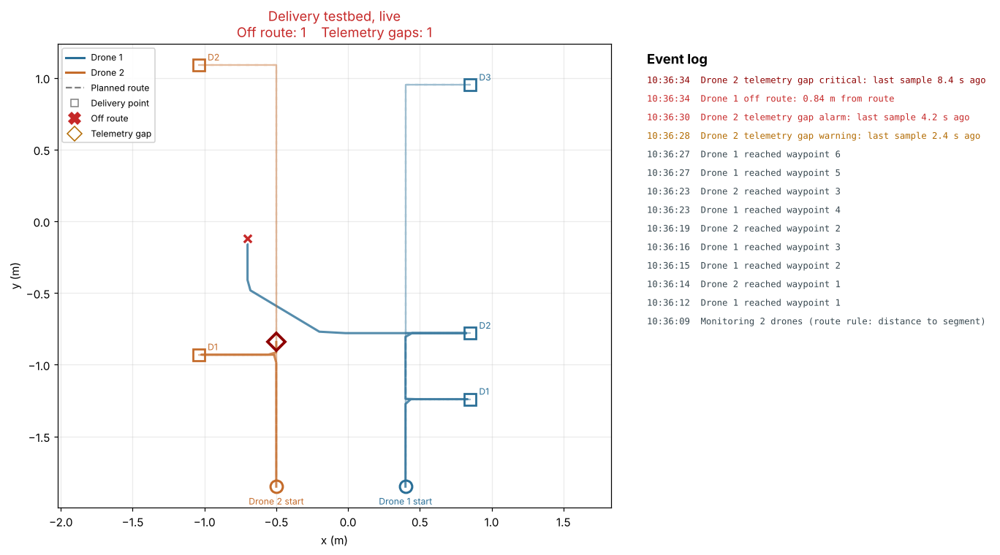

# Crazyflie Delivery Testbed

Software for flying multi-drone delivery missions on a small indoor smart-city
testbed, and for monitoring those flights in real time. It runs on Bitcraze
Crazyflie drones with the lighthouse positioning system, and was built at the
Oklahoma Cyber Innovation Institute (University of Tulsa) as the flight side of
our micro-UAV security research.



## What's here

| File | What it does |
| --- | --- |
| `swarm_mission.py` | Flies every drone in parallel along a grid-aligned delivery route, with a descent at each drop-off, battery checks before every leg, and buffered telemetry logging. |
| `battery_monitor.py` | A small library on top of the Crazyflie's power telemetry. Returns a continue / return-to-base / land decision and estimates remaining flight time from a recorded discharge. |
| `flight_monitor.py` | Rule-based monitor. Flags drones that leave their route or stop sending telemetry, records each outage, and shows a live map with an event log. |
| `missions.py` | Start points and delivery points for each drone, plus the route generator. The mission runner and the monitor both read from here. |
| `simulate_telemetry.py` | Writes realistic telemetry logs, with optional drift and dropouts, so the monitor can be tried without drones. |

## Try it without drones

```bash
pip install -r requirements.txt

# terminal 1
python flight_monitor.py --clean

# terminal 2: drone 1 drifts off route, drone 2 goes silent for 10 s
python simulate_telemetry.py --drift 1 --gap 2
```

```bash
python swarm_mission.py --dry-run   # print each drone's route, no radio needed
python -m pytest                    # run the tests
```

## Flying a mission

You need Crazyflie 2.x drones, a Crazyradio, and a calibrated Loco Positioning
System. Edit `missions.py` to match your space:

```python
MISSIONS = {
    "radio://0/80/2M/E7E7E7E7E9": (
        (0.4, -1.85),                                   # start point (x, y) in metres
        [(0.85, -1.24), (0.85, -0.78), (0.85, 0.95)],   # delivery points, in order
    ),
}
```

Each drone flies along its "street" (the start point's x coordinate), turns off
to reach a delivery point when it isn't on the street, descends 0.7 m to
simulate the drop-off, climbs back, and continues. When the route is done it
flies back to the start point and lands.

```bash
python flight_monitor.py --clean   # optional: start the monitor first
python swarm_mission.py
```

**Safety.** There is no obstacle avoidance; check every route against the room
before flying. **Ctrl+C is a kill switch**: it cuts the motors on every drone
immediately, so fly over a net or soft floor.

## Battery monitor

```python
from battery_monitor import BatteryMonitor, FlightDecision

monitor = BatteryMonitor(cf)          # thresholds come from pm.lowVoltage / pm.criticalLowVoltage
monitor.start()                       # stream power telemetry every 500 ms
if not monitor.wait_for_data():
    raise RuntimeError("no battery telemetry")

decision = monitor.flight_decision()
monitor.status()                      # voltage, %, state, health, suggested action
```

| Condition | Health | Decision |
| --- | --- | --- |
| No telemetry yet | `NO_DATA` | `LAND` (refuse to take off) |
| Firmware reports shutdown, or voltage at or below critical | `SHUTDOWN` / `CRITICAL` | `LAND` |
| Firmware reports low power, or voltage at or below low | `LOW_POWER` / `WARNING` | `RETURN_TO_BASE` |
| Otherwise | `NORMAL` | `CONTINUE` |

`FlightDecision` is an `IntEnum` ordered by urgency, so `decision > FlightDecision.CONTINUE`
means "don't carry on as planned".

**Remaining flight time.** Record one full discharge (a hover or a typical
mission flown until the low-voltage cutoff). The monitor bins voltage to 0.01 V
and stores the average time left at each level:

```python
monitor.record_discharge("discharge_log.csv", duration_s=360)   # runs in the background
# ... later, or in another session:
monitor.load_lookup_from_discharge("discharge_log.csv")
monitor.estimate_remaining_time()       # seconds, from the current voltage
```

Voltage sags under load, so the estimate is only as good as how closely the
recording matches the flight. Record under similar conditions.

`auto_land_if_needed(reserve_s=30)` combines the two for standalone use: it lands
at once on a critical battery, and on a low battery when less than `reserve_s`
of flight is left.

## Flight monitor

The monitor applies two fixed-threshold rules to every drone. They are
deliberately simple: they make a transparent baseline to compare learned
detectors against.

**Off route.** The monitor tracks which waypoint each drone should be heading
to and advances when the drone comes within 0.3 m of it. A drone is off route
if it is further than the tolerance for the current leg (1.0 m on the first leg
and the last two, 0.8 m otherwise), or if it moves faster than 2 m/s between
samples.

**Telemetry gap.** Time since the newest sample: warning after 2 s, alarm after
4 s, critical after 8 s. Alarms repeat every 10 s and critical alerts every 5 s
while the gap lasts. Each outage is recorded with its start time, how long it
took to reach critical, and its total length. They're printed on exit, and
`--outages-csv` saves them.

All thresholds live in the `Thresholds` dataclass at the top of `flight_monitor.py`.

| Option | Effect |
| --- | --- |
| `--path-metric target` | Distance to the next waypoint (default; the original rule). |
| `--path-metric segment` | Distance to the line between the previous and next waypoint. |
| `--route-check URI ...` | Apply the route rule only to these drones. |
| `--clean` | Delete old telemetry logs before starting. |
| `--outages-csv FILE` | Save outage metrics on exit. |
| `--no-plot` | Console output only. |

**Known limitation of the default rule.** Measuring distance to the next
waypoint flags a drone that is exactly on route whenever a leg is longer than
the tolerance. In a simulated perfect flight of the two missions in
`missions.py` (0.22 m/s, one sample every 0.6 s), about 30% of samples are
flagged, all on the long legs. `--path-metric segment`
removes these false alarms and keeps the same tolerances. The original rule
stays the default so earlier results can be reproduced.

## Telemetry log format

`swarm_mission.py` writes one JSON Lines file per drone,
`drone_position_<uri>.jsonl`, which the monitor reads as it grows:

```
#HEADER: {"drone_uri": "radio://0/80/2M/E7E7E7E7E9", "start_time": "...", "mission": [[0.85, -1.24], ...]}
{"timestamp": 1761660000.12, "datetime": "2026-10-28T10:00:00.120", "x": 0.40, "y": -1.80, "z": 0.98, "controller": "CTR-7F3A9C"}
...
{"timestamp": 1761660120.50, "event": "logging_stopped", "stats": {"messages": 198, "dropped": 0}}
```

Position comes from the onboard state estimate every 600 ms. The radio
callback only puts lines on a queue; a background thread writes them to disk,
so slow writes never hold up the link. `controller` is the ground-station ID
(`--station-id`), and the monitor warns if it changes mid-flight.

## Author

Fatemeh Azam, Oklahoma Cyber Innovation Institute, University of Tulsa.
